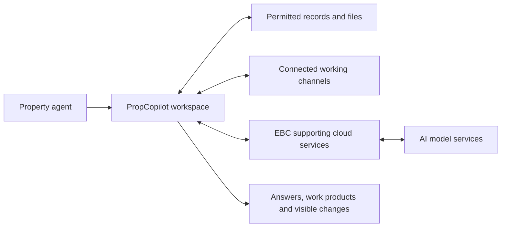
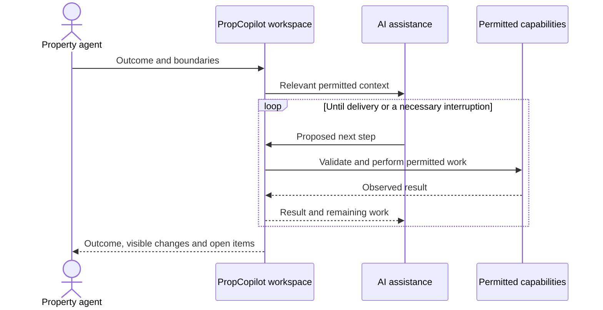

  

<h1 align="center">PropCopilot</h1>

<strong>Your next assistant should do more than chat.</strong>

An AI workspace for property agents. Bring listings, clients, conversations and follow-through into one connected working environment.

  <a href="docs/zh-CN.md">简体中文</a> ·
  <a href="#product">The Product</a> ·
  <a href="#experience">Product Tour</a> ·
  <a href="#agent">How It Works</a> ·
  <a href="docs/how-it-works.md">Technology Overview</a>

> **Public product showcase.** This repository contains selected product material and high-level explanations, not the application source code, internal prompts or an implementation kit. PropCopilot is under active development; availability depends on the current release, connected services and authorized capabilities.

## One place to move property work forward

Property agents do not lack another chat window. They need help turning scattered information into finished work.

A listing can span multiple platforms, photos, documents and conversations. Client requirements change. Follow-ups continue after the first reply. Copying information between these places takes time and makes important details easier to miss.

**PropCopilot is being built around that working reality.** Tell the assistant the outcome you need. It uses the relevant working context, coordinates the necessary capabilities, and helps carry the task forward while keeping you informed and in control.

### What changes for the agent?

| Instead of… | Work toward… |
| --- | --- |
| Finding the same property information in several places | A connected view of listings, platform records and related material |
| Explaining the background every time | Assistance informed by the current task, selected records and permitted preferences |
| Receiving advice, then doing every step manually | Authorized actions and useful deliverables alongside answers |
| Losing track after the first interaction | Visible progress, saved work and support for ongoing follow-through |
| Guessing what an AI actually changed | Clear results, change records and honest statements about unfinished work |

### The work it brings together

| Area | Product focus |
| --- | --- |
| **Listings and material** | Organize property information, work with listing forms, photos, folders and supporting documents |
| **Clients and conversations** | Understand requirements, review leads, prepare communication and support follow-up |
| **Advertising operations** | Work with connected property platforms and ongoing advertising-maintenance tasks |
| **Performance and decisions** | Review available metrics, explain limits and support better-informed decisions |
| **Research and knowledge** | Find relevant market information, professional knowledge and risk context |
| **Tenancy and administration** | Bring agreement information and related administrative workflows into the working environment |
| **Personalized assistance** | Apply permitted preferences and support longer-running goals through Digital Twin capabilities |

These are product areas, not a claim that every action is available or fully validated in every release. Preparing a message is different from sending it; preparing material is different from publishing it.

### Start with an outcome

> “Organize these rental listings, check them against the client's latest requirements, and prepare viewing material. Keep the original files. List what is missing, and do not contact anyone or publish anything yet.”

This is the experience we are building toward: less repeating context and moving information, more time for relationships, judgment and closing the next step.

## A look inside

### Listings: the workspace behind the conversation

Property work needs an organized working surface, not just a conversation history. The Listings view brings records, connected-platform information and related operations together.

### An assistant that shows its work and its limits

In this example, the assistant explains why the available metrics do not support a fair overall platform ranking. A useful assistant should help you understand the evidence, not invent certainty to produce a more confident answer.

*Images originate from owner-supplied product screenshots and have been privacy-edited with AI assistance. Identity, local-path and configuration details are concealed where applicable; other small visual differences may remain. They illustrate the interface, not a performance benchmark, live service status or a guarantee of results. Appearance may change between releases.*

## More than a prompt wrapped around a model

PropCopilot combines a conversational interface, relevant context, specialized assistance and controlled execution.

1. **Understand the request.** Keep the desired outcome and the user's limits together.
2. **Bring in relevant context.** Use permitted records, selected work, related material and useful history.
3. **Choose the next step.** Read information, use a supported capability, coordinate specialist work, or ask for a necessary decision.
4. **Act within the boundary.** The application controls what can execute; model text alone is not permission.
5. **Check and communicate.** Observe the result, continue when needed, and distinguish completion from partial or unknown outcomes.

### 1. How the product fits together

**PropCopilot is the working and execution environment. EBC provides supporting cloud services. AI model services support interpretation and reasoning.** They have different responsibilities; a model response does not directly grant access to the computer.

Cloud-assisted features require connectivity. A desktop workspace is not a promise that all processing happens offline. Access to information and permission to communicate it externally remain separate concerns.

**Read the diagram:** the property agent works in PropCopilot. The workspace brings permitted records and connected channels into the task. EBC supports cloud-assisted functions, including access to AI model services. Results return to the workspace as answers, work products or visible changes.

### 2. The complete Agent workflow

[Open the full-size workflow image](assets/agent-workflow.png).

**Read from top to bottom.** A request becomes a task. The runtime, which manages the task as it runs, brings together instructions and relevant context. It asks for a next step, checks whether that step may execute, observes the result, and continues toward delivery.

| Stage | What it means | Why it matters |
| --- | --- | --- |
| **Request and task state** | Keep the requested outcome, boundaries and progress together | The work has a goal beyond producing a reply |
| **Prompt and context** | Combine operating guidance with relevant, permitted records, history and preferences | The assistant can work with the situation, not only the latest sentence |
| **Decision** | Select a useful next step: find information, use a capability, coordinate specialist help or ask a question | Different tasks can follow different paths |
| **Controlled execution** | Check the proposed action against the applicable permissions and requirements | Model output alone cannot authorize an action |
| **Observation and continuation** | Read back what happened and use that result in the next decision | A failed step or missing fact can change the plan |
| **Review and delivery** | Compare the result with the requested outcome; report completed work and open items | A proposed finish is not automatically a completed task |

**The side paths matter too.** A necessary decision can pause the work. Continuing requires checking the current situation again. Stop ends further work; it does not undo effects already committed. Saved progress supports continuity, not a promise that any interrupted task can always recover.

*Owner-supplied explanatory diagram. It communicates the architecture at a conceptual level, not a public API, fixed model configuration or complete acceptance record. Named paths illustrate the design; availability depends on the release and authorized capabilities.*

### 3. What happens during a task

**The key is the return path.** Reasoning proposes a step; the application controls execution; the observed result informs the next step. Specialist help, when needed, contributes to the same requested outcome rather than creating unrelated work.

For the rental-listing example above, this could mean reading the selected records, checking the client's requirements, preparing supported viewing material, and checking the saved output. Missing information stays visible. The instruction not to contact anyone or publish anything continues to apply throughout the task.

These diagrams explain the intended working principles, not a guarantee that every path is available or validated in every release. See [How PropCopilot Works](docs/how-it-works.md) for more context without proprietary implementation details.

## User control is part of the product

- **Scope matters.** Looking at information is not the same as authorizing a change or a message.
- **Important actions have boundaries.** Sensitive operations depend on the applicable permissions and confirmation requirements.
- **Stop is not undo.** Previously committed work must be represented honestly.
- **Uncertainty stays visible.** Missing information and incomplete work should not be presented as successful outcomes.
- **Personalization does not expand authority.** A saved preference is not permission to do more than the user requested.

These are design principles and areas of ongoing engineering and validation, not a claim of infallibility or a security certification.

## The longer-term direction

Our focus is property agents: helping them delegate more of the computer-based assistant work around their business. The wider ambition is to bring the same outcome-oriented approach to other operations-heavy fields, including e-commerce.

That ambition does **not** mean unrestricted computer control, universal software compatibility or a released e-commerce product today.

## About this repository

This is a presentation repository, not the product's development repository. It intentionally excludes product code, internal prompts, private data, deployment details and security-sensitive implementation material.

For product information and inquiries, start with the [EstateBoostCopilot organization](https://github.com/EstateBoostCopilot). Do not post customer records, credentials or private business material in public issues.

Product materials © 2026 EstateBoostCopilot. Third-party names and marks belong to their respective owners. Public availability of this showcase does not make the PropCopilot application an open-source release.
