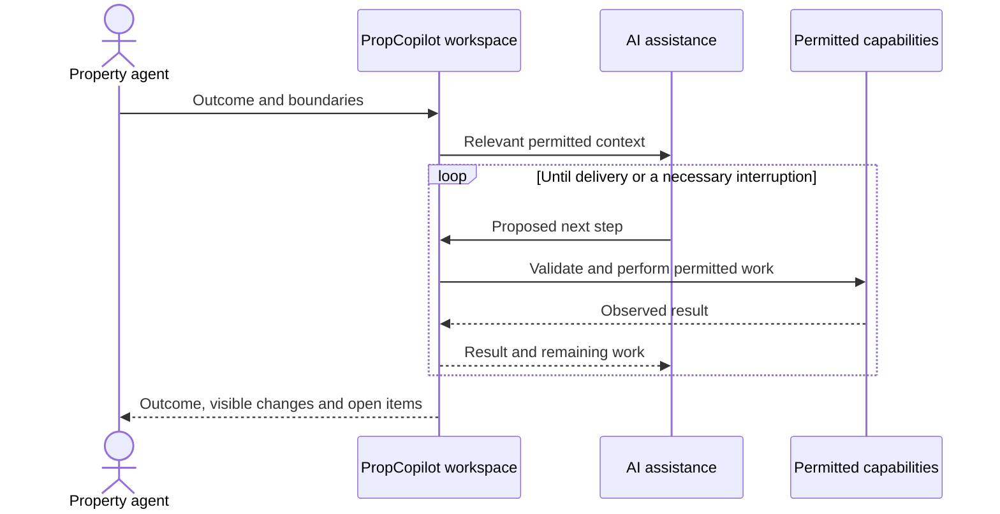

# How PropCopilot Works

**A technology overview for customers, partners and product-minded readers.**

[Product showcase](../README.md) · [简体中文](zh-CN.md#agent-如何工作)

PropCopilot is designed around a simple separation: models help interpret and decide; the application governs execution; the result must come back into the working process.

This page explains those responsibilities. It intentionally does not publish internal prompts, interfaces, data structures, deployment topology or security-control implementation.

## 1. The conversation starts a task, not just a reply

A useful request includes an outcome and boundaries: which work to handle, what to preserve, what to prepare, and what not to send or publish.

The assistant should retain both parts. Producing a nearby answer is not the same as completing the requested work.

## 2. Context turns a general model into relevant assistance

Relevant context may include the selected record, permitted business information, attached material, related history and user preferences. More context is not automatically better: information must be relevant to the work and permitted for that use.

Three distinctions matter:

- **Instructions** describe the task and operating guidance.
- **Information** provides facts, observations or historical context.
- **Authority** determines what actions are allowed.

A document can contain useful facts without gaining the right to instruct the assistant. A remembered preference can shape a response without authorizing a new action.

## 3. Reasoning and action form a feedback loop

The assistant can obtain information, use a supported capability, coordinate specialist work or ask for a necessary decision. The application validates the proposed action before execution.

After execution, the result becomes input for the next decision. This is what makes multi-step work possible: the next step depends on what actually happened, not only on the original plan.

This is a conceptual illustration. It is not a tool contract or a promise that every depicted path is available in every release.

## 4. Specialist help should reduce fragmentation

Property work crosses domains: listings, client service, advertising, research, performance and administration. Specialist responsibilities help keep the right knowledge with the right work.

Coordination should carry the original requirements and relevant results forward. It should not make the user repeat the same background, trigger unnecessary handoffs or widen what was authorized.

Specialization is a product organization principle, not a requirement to run every specialist for every task.

## 5. Progress must survive more than one interaction

Real work can pause for information, depend on a connected service, or continue later. The system is designed to preserve progress and distinguish completed work from outstanding steps.

Continuing work requires checking the current situation. A prior action may already have happened; repeating it is not automatically safe. A stopped task is also not an instruction to undo everything that came before it.

This continuity is an engineering objective with ongoing validation, not a universal recovery guarantee.

## 6. Completion is about the outcome

A convincing final message is not sufficient evidence of an effect. An answer, prepared document, saved draft, sent message and published advertisement are different outcomes.

The delivery process should communicate what was completed, what changed, what remains uncertain and which decisions still belong to the user. Review helps check the work, but does not replace authoritative records or independent validation.

## 7. Desktop work and cloud assistance have different roles

PropCopilot provides the working environment and supported execution capabilities. EBC supplies supporting cloud services. AI model services provide reasoning support.

These responsibilities are deliberately described separately. Cloud-assisted work may involve permitted context or attachments; a desktop interface alone does not imply that all processing stays on the device.

## What this public overview does not claim

- Unrestricted access to a user's computer or every connected account.
- Compatibility with every desktop application or every third-party workflow.
- Automatic permission to contact people, publish content or spend money.
- Guaranteed business outcomes, error-free reasoning or a security certification.
- A reproducible blueprint for the proprietary application.

The public explanation is about product principles and engineering responsibilities. Feature availability and validation remain release- and integration-dependent.
