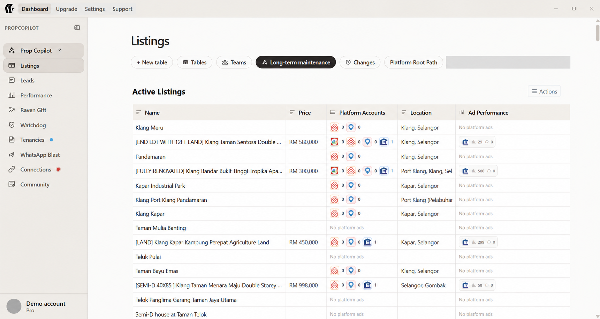
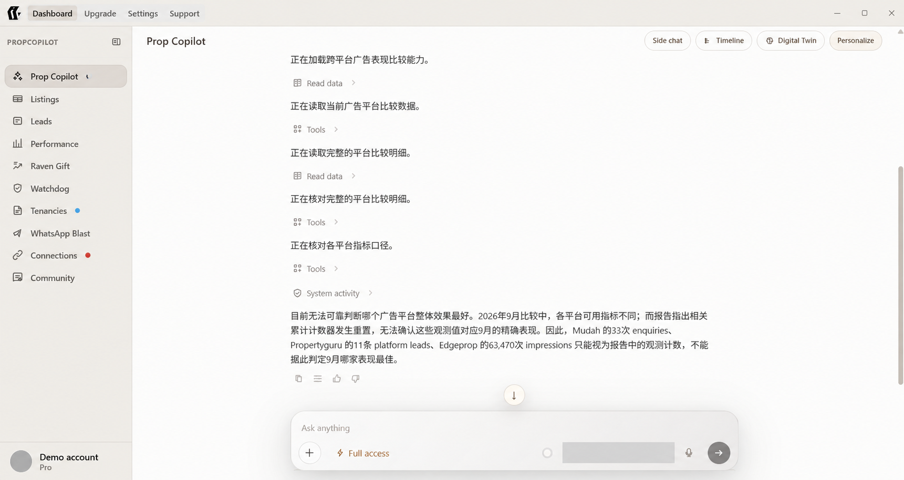
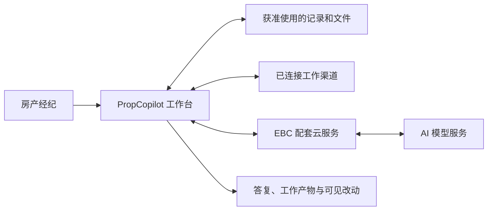
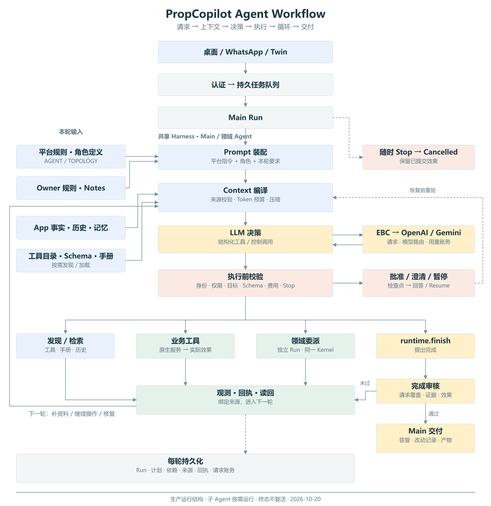

# PropCopilot

**让房产经纪的 AI 助手，不只回答问题，也能把工作做下去。**

[English](../README.md) · [产品展示](#产品展示) · [Agent 原理](#agent-如何工作) · [技术概览](how-it-works.md)

> 这是独立的公开产品展示仓库，不包含产品源码、内部 Prompt 或复刻教程。产品仍在持续开发；具体功能取决于版本、连接服务和当前授权。

## 它是什么，为谁而做

PropCopilot 是面向 **Property Agent，房产经纪** 的 AI 工作台。它把房源、客户、沟通、文件和日常运营放进同一个工作环境，让用户围绕目标交代工作，而不是在不同页面之间反复复制资料。

房产经纪真正需要的，不只是一个聊天窗口。一次带看准备，可能涉及房源筛选、客户新条件、照片、文件和后续沟通。PropCopilot 的方向是把这些工作连起来：理解要求、查对资料、执行已授权操作，并把结果和未完成项清楚交回用户。

## 从客户角度，能带来什么

| 日常困扰 | 产品价值方向 |
| --- | --- |
| 房源资料分散在平台、表格和文件夹 | 集中查看和整理，减少重复查找 |
| 每次都要重新说明客户和房源背景 | 结合当前工作、选中记录和获准使用的偏好 |
| AI 给了建议，操作仍要自己逐步做 | 在支持范围内执行已授权动作，准备实际产物 |
| 一次回复之后，工作没有继续跟进 | 保留进度，支持持续事项和后续处理 |
| 不清楚 AI 到底改了什么 | 提供可查看的结果、改动和未完成说明 |

### 主要工作版图

- **房源与资料：** 房源整理、平台表单、照片与关联文件、材料准备。
- **客户与沟通：** Leads、客户要求、消息准备及跟进工作。
- **广告与运营：** 连接房产平台，支持日常广告操作和维护工作。
- **绩效与判断：** 阅读现有指标，说明统计限制，辅助比较与决策。
- **研究与知识：** 市场信息、专业知识、机会研究与风险背景。
- **租约与行政：** 协议资料及相关行政流程。
- **个性化与持续协作：** 偏好、工作指导、记忆及 Digital Twin 目标能力。

这张版图不是“所有场景已经全部可用”的承诺。草稿不等于发送，准备不等于发布，模拟也不等于真实执行。

### 可以怎样交代工作

> 整理这批出租房源，按客户最新预算和车位要求筛选，准备一份带看材料。保留原文件，缺少的资料列出来，先不要联系客户或发布广告。

目标是让用户管理**结果与边界**，把更多时间留给客户关系、专业判断和业务推进。

## 产品展示

### 房源工作台

把实际工作记录放在对话背后，减少“聊完之后还要自己重新整理”的断层。

### 看得见过程，也说得清限制

示例中的助手没有强行选出“最佳广告平台”，而是说明不同指标和资料限制。我们希望助手提供有依据的帮助，而不只是更有把握的语气。

*以上图片来自项目方提供的产品截图，经过 AI 辅助隐私处理，遮去了适用位置的账号身份、本地路径和配置细节；其他细小视觉差异可能存在。图片只说明界面，不作为业绩、即时服务状态或验收证明。界面可能随版本调整。*

## Agent 如何工作

**理解目标 → 选择相关上下文 → 决定下一步 → 受控执行 → 核对结果 → 交付或继续。**

模型负责理解和选择，应用负责执行边界。相关能力可以协作，但不需要每项任务都启动所有角色。已完成的工作、需要用户决定的事项以及仍未知的结果，应分别保留。

PropCopilot 是工作与执行端，EBC 提供配套云服务，模型提供推理能力。三者不是同一件事；模型说“执行”不代表它已经获得电脑操作权。本地工作台也不等于完全离线，云端辅助功能仍需要网络。

<strong>查看 Agent 工作流图</strong>

图由项目方提供，用于解释高层结构，不是公开接口、固定模型配置或完整验收记录。

### 从工程角度，关键不只是 Prompt

| 能力 | 对客户的意义 |
| --- | --- |
| 当前任务与相关资料一起进入上下文 | 少重复解释，也不把无关资料混进工作 |
| 指导、事实与权限分开 | 网页文字、旧对话和个人偏好不能自行扩大授权 |
| 必要时协调专业能力 | 多步工作能衔接，不只给零散回答 |
| 应用控制执行，结果回到工作循环 | 助手根据实际结果继续，而不是只描述“做了什么” |
| 保存进度并支持中断处理 | 尽量保留已完成成果，不靠重做整项任务接续 |
| 交付时明确完成、部分完成与未知 | 用户知道现在能用什么，还欠什么 |

更多原理见 [公开技术概览](how-it-works.md)。公开版不提供完整 Prompt、调用契约、内部数据结构或安全校验实现。

## 用户始终保有控制

资料可读取，不代表可以对外发送。敏感操作仍受相应的权限和确认条件约束。Stop 用来停止后续工作，不会自动撤销已提交操作；偏好与记忆也不会赋予额外权限。

这些是产品设计原则与持续验证方向，不是“永远不会出错”或安全认证承诺。

## 长期方向

先服务好房产经纪，让更多电脑上的助手事务可以按目标交给 Agent。未来希望把这套面向结果的协作方式扩展到电商等业务。

这是愿景，不代表目前已经支持任意电脑软件、无限制操作，或已发布电商产品。

## 关于公开范围

本仓库只展示产品价值和高层原理，不是产品开发仓库，不包含软件安装包或源码开放许可。内部实现、真实客户资料、凭据和部署信息不在展示范围内。

产品咨询可从 [EstateBoostCopilot](https://github.com/EstateBoostCopilot) 了解。请勿在公开 issue 上传客户资料、凭据或私密业务内容。

产品资料 © 2026 EstateBoostCopilot。第三方名称及标志归其权利人所有。
